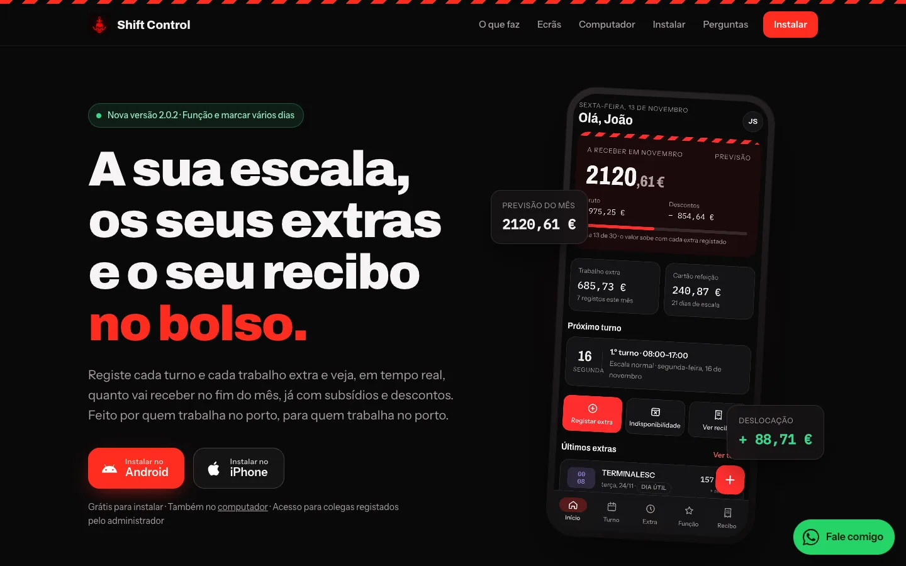
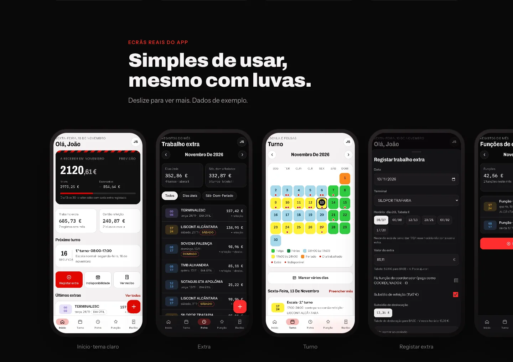
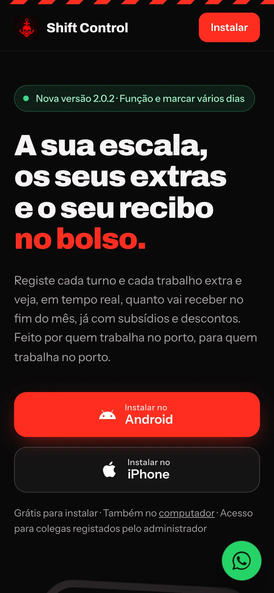
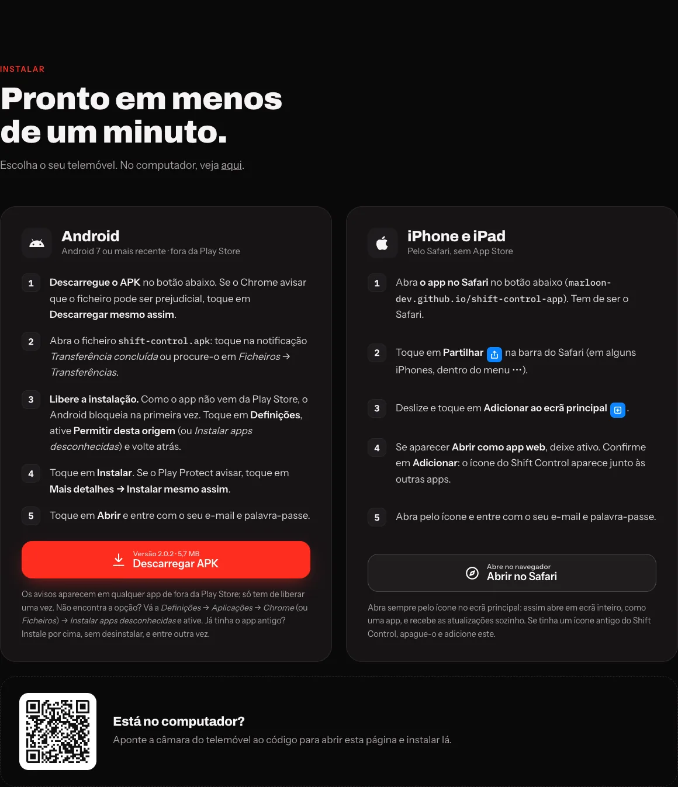
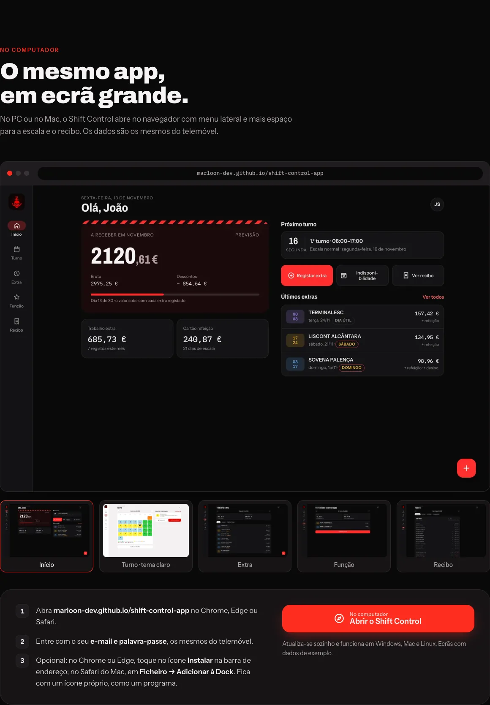
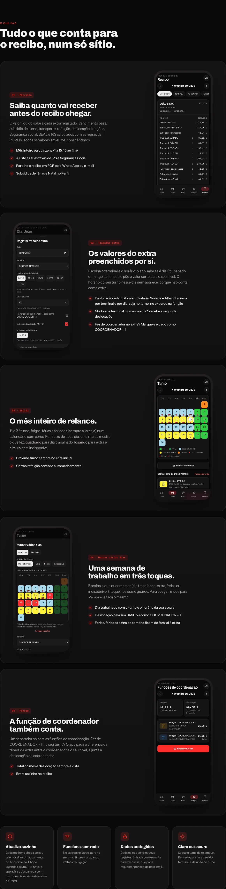
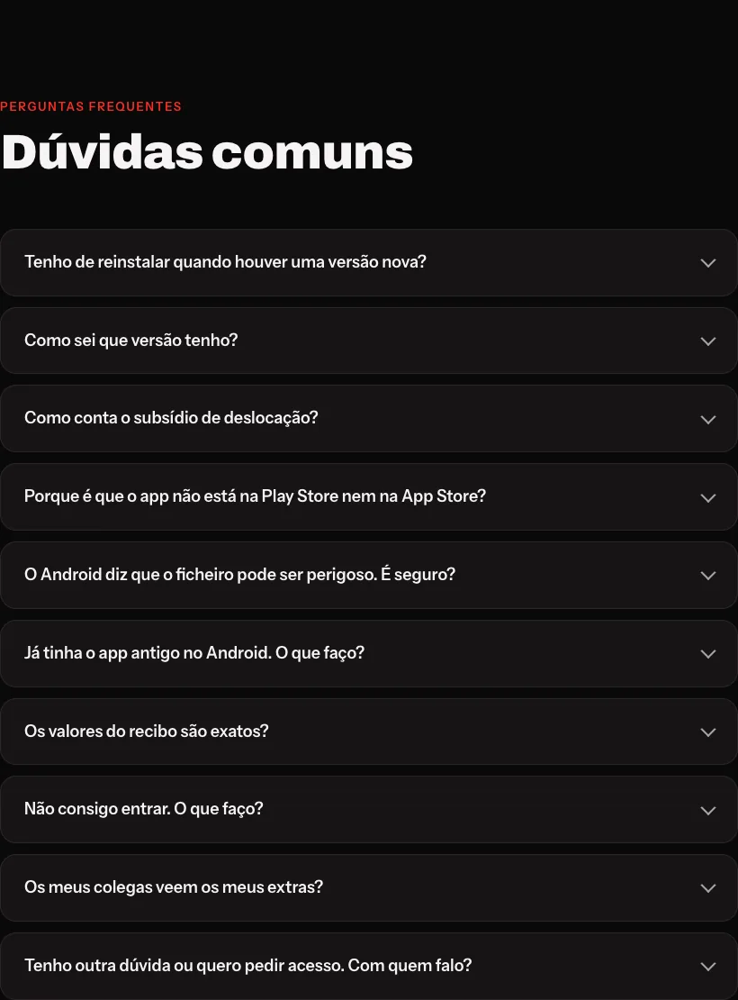
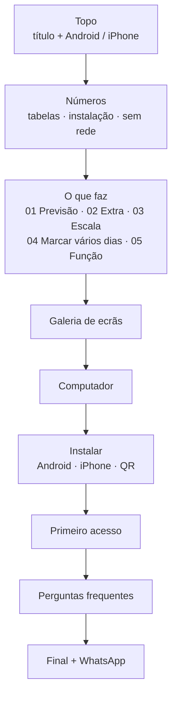

<div align="center">


# Shift Control · site de instalação

**A página onde os colegas instalam o Shift Control no Android, no iPhone ou no computador.**

[](https://marloon-dev.github.io/shift-control-site/)
[](https://marloon-dev.github.io/shift-control-site/shift-control.apk)
[](https://wa.me/351922242250)

<br>



</div>

<br>

## 🎯 Para que serve

| Objetivo | Como o site resolve |
| --- | --- |
| **Instalar em menos de um minuto** | Deteta o telemóvel (Android ou iPhone) e destaca o botão certo; passos numerados com os textos exatos que aparecem no ecrã. |
| **Explicar o que o app faz** antes de instalar | Secções com ecrãs reais e o porquê de cada função. |
| **Tirar o medo do "ficheiro perigoso"** | Explica o aviso do Android e porque é seguro (assinatura, sem permissões extra). |
| **Uma resposta para cada dúvida** | Perguntas frequentes e um botão de **WhatsApp** sempre visível. |
| **Distribuir o APK sem Play Store** | `shift-control.apk` é servido diretamente por este repositório. |

<br>

## 🖼️ Ecrãs do site

<table>
<tr>
<td width="62%"></td>
<td rowspan="2" align="center"><br><sub><b>No telemóvel</b>: botões a toda a largura e WhatsApp flutuante só com o ícone</sub></td>
</tr>
<tr>
<td><sub><b>Galeria</b>: desliza na horizontal, com captura de cada ecrã do app</sub></td>
</tr>
</table>

<details open>
<summary><b>📥 Instalar: Android e iPhone lado a lado</b></summary>
<br>

</details>

<details>
<summary><b>💻 No computador: pré-visualização com 5 ecrãs</b></summary>
<br>

</details>

<details>
<summary><b>✨ O que faz: as cinco funções principais</b></summary>
<br>

</details>

<details>
<summary><b>❓ Perguntas frequentes</b></summary>
<br>

</details>

<br>

## 🧭 Estrutura da página



**Porquê esta ordem:** primeiro o *quê* (o que ganho com isto), depois o *como* (instalar) e no fim as *dúvidas*. Quem já está convencido salta direto para **Instalar**: há atalhos no topo e um link "Saltar para a instalação" para leitores de ecrã.

<br>

## 🎨 Decisões de design (UI/UX)

| Decisão | Porquê |
| --- | --- |
| **Mesma identidade do app** (preto, vermelho de sinalização, faixa de perigo do cais) | Quem vem do site reconhece o app logo à primeira. |
| **Botão da plataforma certa em destaque** (`site.js`) | Menos uma decisão: no iPhone aparece o caminho do Safari, no Android o APK. |
| **Passos com os textos reais do Android/iOS** (*"Permitir desta origem"*, *"Adicionar ao ecrã principal"*) | A pessoa procura no ecrã exatamente as palavras que leu. |
| **Ecrãs reais com dados fictícios** | Mostra o produto de verdade sem expor dados de colegas. |
| **WhatsApp flutuante** (verde, canto inferior) | O contacto direto está a um toque em qualquer ponto da página. |
| **Código QR** na versão de computador | Quem abriu no PC passa para o telemóvel sem escrever o endereço. |
| **Imagens WebP com `width`/`height`, `loading="lazy"` e `?v=` na URL** | Carrega rápido em rede móvel, sem saltos na página, e as imagens novas aparecem logo após cada atualização. |
| **Acessibilidade** | `alt` em todas as capturas, foco visível, `aria-pressed` nas miniaturas, contraste alto e `prefers-reduced-motion` respeitado. |
| **Português europeu** | É a língua do porto e do recibo. |

<br>

## 🗂️ Ficheiros

```text
shift-control-site/
├── index.html          a página (HTML semântico, sem frameworks)
├── estilo.css          identidade visual, layout e responsivo
├── site.js             deteta a plataforma e troca os ecrãs do computador
├── shift-control.apk   APK Android assinado (versão atual)
├── img/                capturas do app (WebP), ícones e QR
└── docs/               imagens deste README
```

> [!NOTE]
> Sem build nem dependências: são três ficheiros servidos tal como estão pelo GitHub Pages.

<br>

## 🚀 Publicar uma versão nova do APK

O APK é publicado a partir do repositório do código, com um só comando:

```sh
bash scripts/release-android.sh "O que mudou nesta versão"
```

| Passo | Automático |
| --- | :---: |
| Gera e assina o APK no GitHub Actions | ✅ |
| Cria a release `android-v<versão>` | ✅ |
| Substitui `shift-control.apk` aqui e atualiza **versão** e **tamanho** no `index.html` | ✅ |
| Espera até o GitHub Pages servir o APK novo | ✅ |
| Avisa os apps instalados: **"Nova versão do app"** | ✅ |

**Alterações só de texto ou imagens:** editar `index.html` / `img/`, subir o `?v=` das imagens trocadas e fazer `git push`. Fica online em 1 a 2 minutos.

<details>
<summary><b>Ver o site localmente</b></summary>
<br>

```sh
python3 -m http.server 8765
# abrir http://localhost:8765
```

</details>

<br>

## 🔗 Repositórios do Shift Control

| Repositório | O que tem |
| --- | --- |
| [`shift-control`](https://github.com/marloon-dev/shift-control) *(privado)* | Código-fonte do app, banco de dados e Android |
| [`shift-control-app`](https://github.com/marloon-dev/shift-control-app) | App publicado (web + atualizações do Android) |
| **`shift-control-site`** | Esta página de instalação e o APK |

<br>

<div align="center">
<sub>Shift Control · <a href="https://marloon-dev.github.io/shift-control-site/">marloon-dev.github.io/shift-control-site</a> · <a href="https://wa.me/351922242250">WhatsApp +351 922 242 250</a></sub>
</div>
